<div align="center">

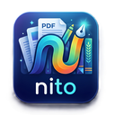

# Nito

**Üniversite öğrencileri için ders PDF'i, ders kaydı ve sınav hazırlığı tek uygulamada.**

Slaytı oku, üstüne yaz, dersi kaydet, hocanın anlattığı ana geri dön, kartlarla çalış.
Her şey cihazında, internetsiz çalışır.


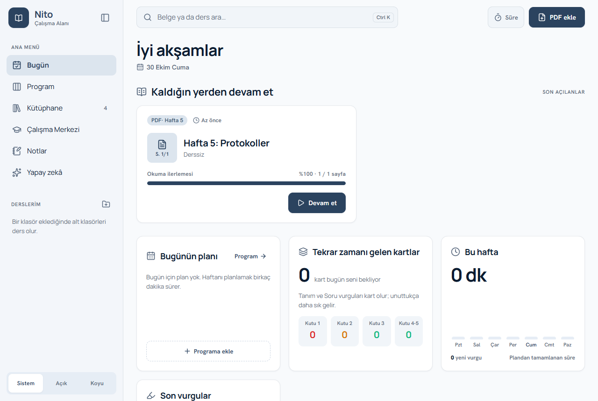

</div>

---

## İçindekiler

- [Özellikler](#özellikler)
- [Ekran görüntüleri](#ekran-görüntüleri)
- [Platformlar](#platformlar)
- [Gizlilik](#gizlilik)
- [Geliştirme](#geliştirme)
- [Mimari](#mimari)
- [Testler](#testler)
- [Yol haritası](#yol-haritası)
- [Lisans](#lisans)

## Özellikler

### Bugün ve Program
- Açılış ekranı: kaldığın belgeler, bugünün planı, kutulara göre tekrar zamanı gelen kartlar, haftalık çalışma grafiği, sıradaki sınava kalan gün, son vurgular ve kayıtlar.
- Haftalık ders programı: gün sütunları, bugün vurgulu, haftalık tekrar, sürükleyerek başka güne taşıma, tamamlandı işareti.

### Görünüm
- Sakin, tablet öncelikli tasarım: koyu çivit tonları, Manrope ve Hanken Grotesk yazı tipleri (uygulamanın içinde, internetsiz).
- Açık, koyu ve sistem teması. Kenar çubuğu tablette ikon şeridine, telefonda çekmece ve alt menüye dönüşür.
- Her ekrandan arama (Ctrl+K) ve "PDF ekle".

### Kütüphane
- Kapak resimli kartlar ya da liste görünümü, derse göre filtre, sıralama.
- 500 sayfalık taranmış PDF'lerde bile akıcı: yalnız görünen sayfalar çizilir, bellek sınırlıdır.
- Hızlı arama (Ctrl+K), Türkçe karakterlere duyarsız.
- Okuma ilerlemesi ve **"Kaldığın yerden devam et"**.
- Ad değiştirme, derse ya da haftaya taşıma, silme: sağ tık, uzun basma ya da `⋯` menüsü.
- İzlenen klasörler: bir klasöre eklenen PDF'ler kütüphaneye kendiliğinden gelir.

### PDF okuyucu
- Etiketli vurgular (Sınav, Tanım, Soru …) ve vurgulara yorum.
- Tek **Kalem** düğmesi: varsayılan siyah tükenmez. Açınca **tükenmez, kurşun kalem, fosforlu**, 10+ renk, özel renk ve kalınlık. Silgi ve ayrı **lazer kalem**.
- Basınca duyarlı kalem desteği. **Avuç içi ve yanlış dokunma engeli**: büyük temaslar ve kalem ekrandayken gelen dokunuşlar yok sayılır. "Yalnız kalemle çiz", "Parmakla da çiz" ve dokunma hassasiyeti ayarı.
- **Şekil düzeltme:** çizginin sonunda kalemi bekletince yamuk çizgi düz çizgiye dönüşür; daire, dikdörtgen, üçgen ve ok da tanınır. El yazısına dokunulmaz, geri alınabilir.
- **Seç aracı:** kementle yazı ve çizimleri seç; taşı, büyüt, küçült, rengini değiştir, kopyala, kes, sil, geri al.
- **Başka sayfaya taşı:** seçimi başka sayfaya sürükle ya da "Sayfaya taşı" ile sayfa numarasını yaz. Yazı, metin kutusu ve resim birlikte taşınır.
- **Resim** menüsü: dosyadan, panodan yapıştırarak, tarayıcıdan sürükleyerek ya da bağlantıdan. Taşıma ve boyutlandırma.
- **Boş sayfa ekleme ve kaldırma:** istediğin yere ekle, "Sayfayı kaldır" ile sil; PDF dosyası değişmez.
- **Defter:** PDF'in yanında açılan not defteri. Düz beyaz sayfayla başlar; düz, kareli, çizgili ya da noktalı sayfa eklenir. Kalem, metin ve notlar burada da çalışır. Telefonda PDF'in üstüne açılır.
- **Önemli sayfalar:** "Önemli" işaretli sayfalar yanda küçük ayrı bir PDF gibi durur; istersen gerçek PDF olarak kaydedilir.
- **Metin kutusu ve yapışkan not:** LaTeX formül (KaTeX) ve renkli kod bloğu desteğiyle. Notlar için 7 renk.
- **Bant modu:** tanımı ya da formülü bantla kapat, dokununca aç; kendini test et.
- **Katmanlar:** vurgu, kalem, resim, not ve bant katmanlarını ayrı ayrı gizle ya da göster.
- **Kenar boşluğu:** dolu slaytın sağına ya da altına yazı alanı ekle; PDF bozulmaz.
- **İşaretler:** sayfayı "Hoca vurguladı", "Sınav adayı" ya da "Anlaşılmadı" olarak işaretle.
- Belgede arama (Ctrl+F), sayfa numarasıyla atlama, sayfa küçük resimleri ve içindekiler.
- İki parmakla yakınlaştırma, kaydırarak sayfa değiştirme, iki belgeyi yan yana açma.

### Ders kaydı
- PDF açıkken **ses kaydı**. Kayıt sırasında yapılan vurgu, hocanın o anki sözüne bağlanır: ▶ 12:40.
- **Slayt–ses senkronu:** kayıt sırasında hangi sayfada olduğun saklanır. Sayfadaki ▶ düğmesi, hocanın o sayfayı anlattığı ana atlar.
- **Notları sesle birlikte göster:** dinlerken o anda aldığın vurgu ve çizimler zamanı gelince belirir.
- **Sessizliği atla**, **gürültü azalt**, 0,5×–2,5× hız (sesin tonu korunur), 10 sn geri/ileri, kayıt silme.
- **Döküm sayfanın yanında:** her sayfanın yanında (telefonda altında) o sayfada söylenenler, süreye dokununca ses o andan çalar.
- **Sınav ipuçları:** dökümde "sınavda çıkar", "önemli", "dikkat" gibi sözler geçen sayfalara rozet konur.
- **Yazıya dökme** (masaüstü): whisper.cpp ile cihazda, internetsiz. Önerilen model Türkçede daha doğru large-v3-turbo (574 MB). Ders adı ve PDF'teki terimler modele ipucu olarak verilir; sessiz yerler (VAD) ve "İzlediğiniz için teşekkürler" gibi uydurma satırlar ayıklanır. Dökümdeki her paragrafa tıklayınca ses o andan çalar.

### Kronometre ve alarm
- Üst çubuktaki "Süre" düğmesi: kronometre ve dakika ayarlı alarm. Okuyucuyu kapatsan da sayar.
- Kronometre çalışırken geçen süre açık olan PDF'e yazılır; Çalışma Merkezi'nde PDF ve ders başına "Çalışma süresi" görünür.

### Çalışma
- Vurgulardan otomatik kart; aralıklı tekrar (Leitner 1/2/4/8/16 gün), kutu dağılımı ve ders başına ilerleme halkası.
- Çoktan seçmeli quiz, Cornell not şablonu.
- **Sınav hazırlığı:** işaretlenen sayfalar ve Sınav etiketli vurgular tek listede; derse, haftaya ve türe göre filtre.
- Ders paketi: bir dersin PDF'leri, notları ve kartları tek dosyada.

### Notlar
- Her PDF için canlı not, ders başına renk özeti, serbest notlar.
- Notlardan vurgunun bulunduğu sayfaya bağlantı.
- Markdown olarak dışa aktarma.

### Yapay zekâ (masaüstü)
- Belge özeti ve belgeyle sohbet; cevaplar sayfa numarasıyla kaynak gösterir: [s. 4].
- Sohbet, ders kaydının dökümünü de kaynak gösterir: [kayıt 12:40]. Tıklayınca ses o andan çalar.
- **Slayttan kart üret:** seçtiğin sayfalardan tanım kartları ve çoktan seçmeli sorular; kaydetmeden önce düzenlersin.
- **Kurulum gerekmez.** "Yapay zekâyı kur" düğmesi motoru ve modeli indirir:
  - Hızlı: Qwen3-4B, 2,3 GB
  - Kaliteli: Qwen3-8B, 4,7 GB
- Her şey bilgisayarda çalışır, belgeler hiçbir sunucuya gitmez.
- Mobilde yapay zekâ bölümü yoktur.

### Yedekleme
- Kütüphanenin tamamını (veritabanı ve dosyalar) bir klasöre yedekleme ve geri yükleme. Bulut sürücü klasörü de olur.

## Ekran görüntüleri

| Bugün | Kütüphane |
|---|---|
|  | 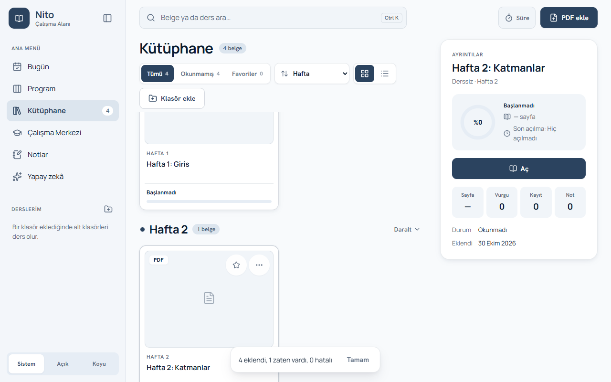 |
| **Çalışma Merkezi** | **Okuyucu ve Kalem grubu** |
| 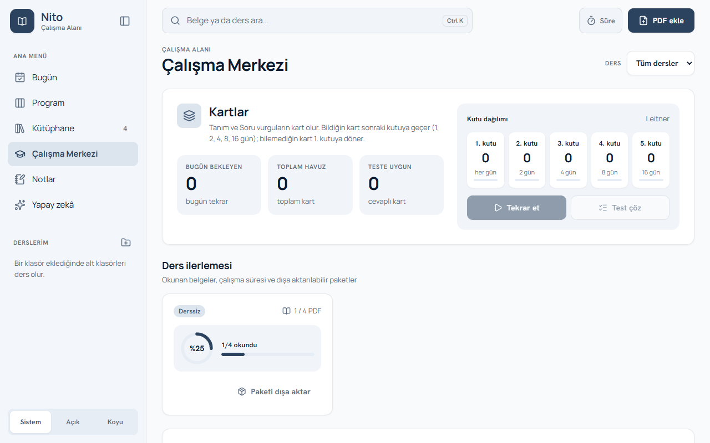 | 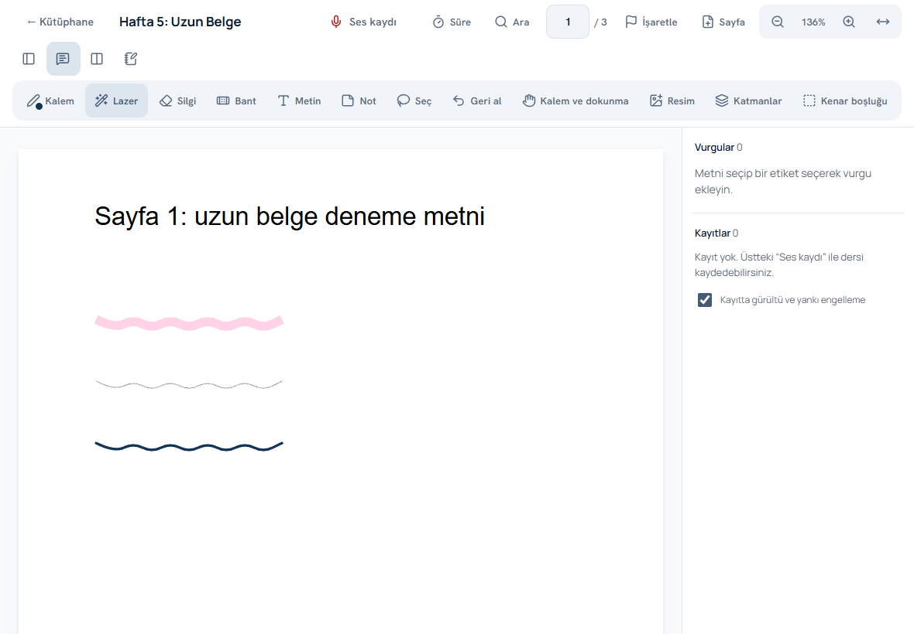 |
| **Defter** | **Bant, not ve LaTeX** |
| 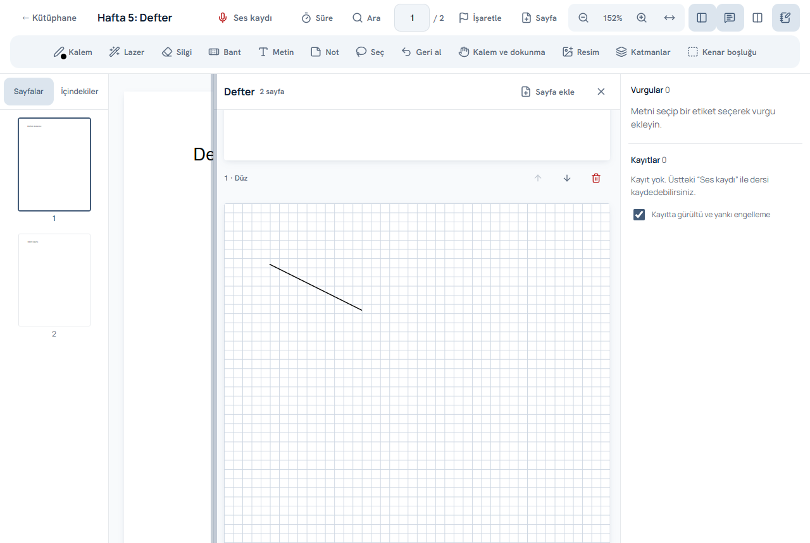 | 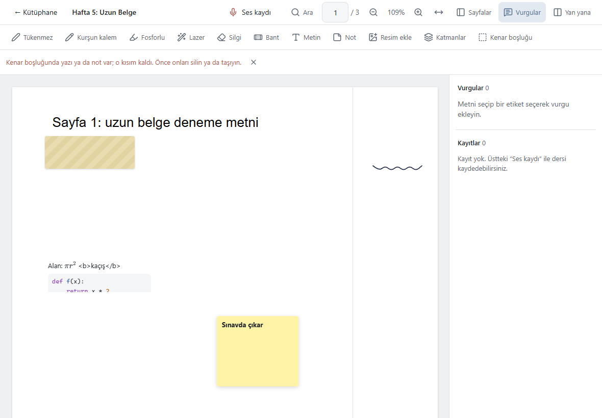 |
| **Haftalık program** | **Yapay zekâ ile sohbet** |
| 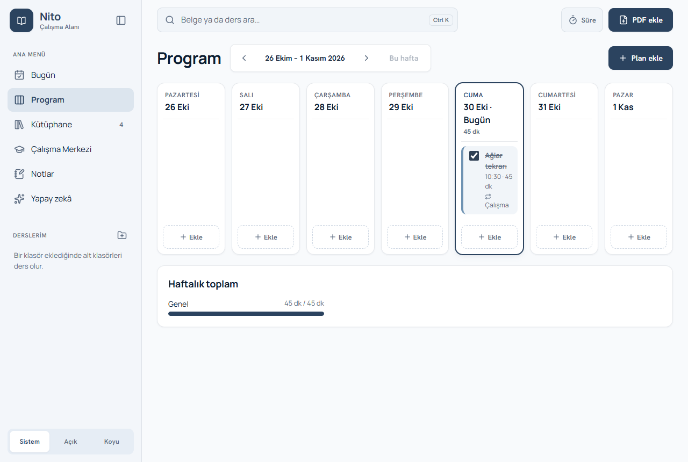 | 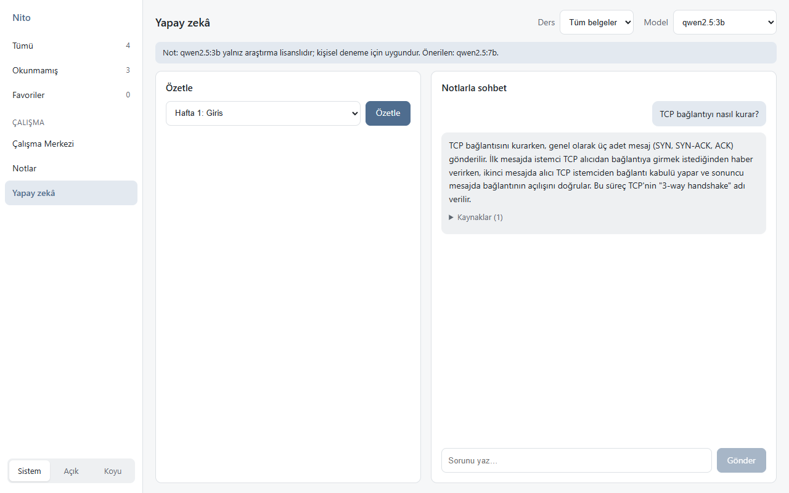 |
| **Sınav hazırlığı** | **Koyu tema** |
| 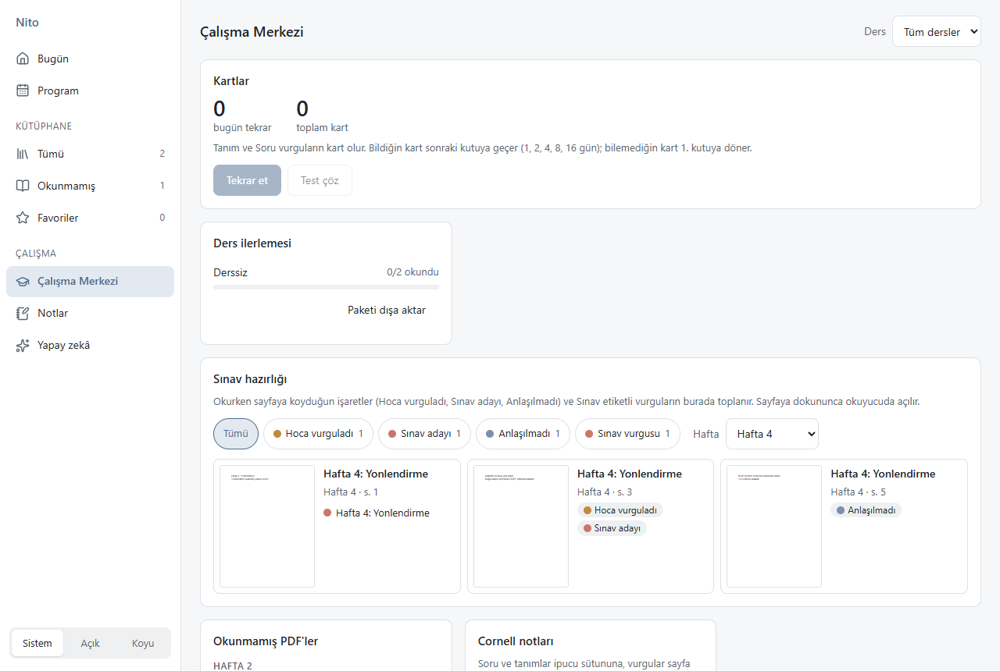 | 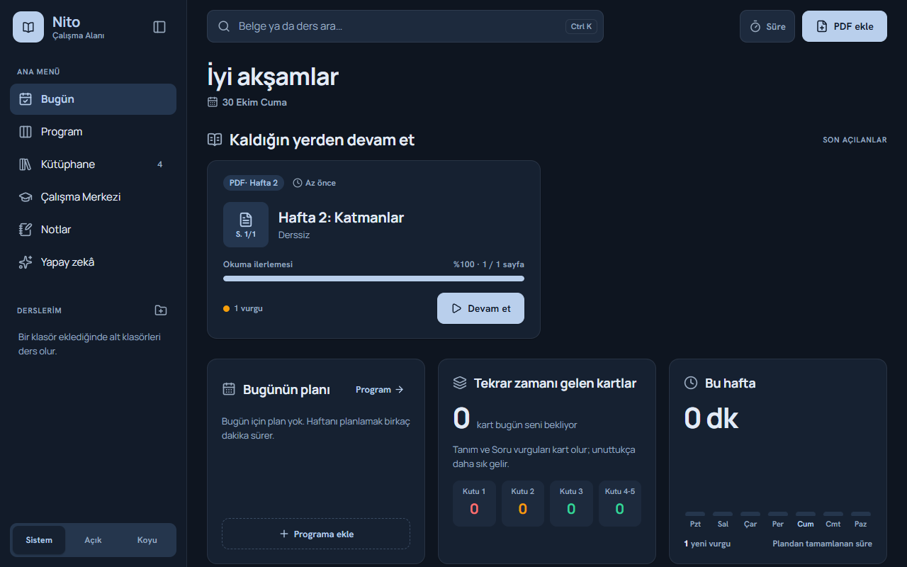 |

Telefon görünümü:

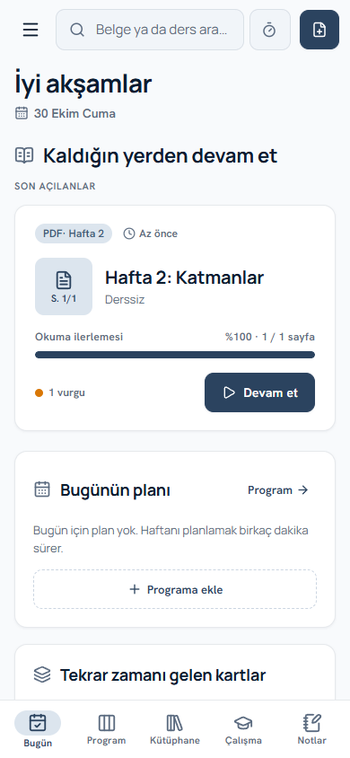 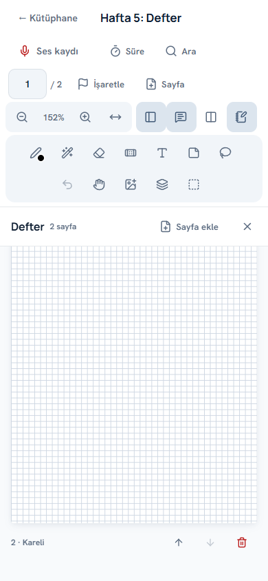

Tablet görünümü:

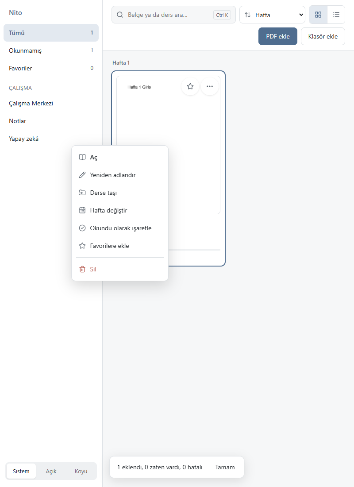

## Platformlar

| Platform | Durum |
|---|---|
| Windows 10/11 (x64) | Çalışıyor; NSIS kurulum dosyası üretiliyor |
| Android tablet | Aynı kod; derleme hazır, yayın sonra |
| iPad | Aynı kod; derleme için Mac ve Xcode gerekir |

Yapay zekâ ve yazıya dökme şimdilik yalnız masaüstünde çalışır. Diğer her şey tüm platformlarda aynıdır.

## Gizlilik

- Veriler cihazdaki yerel bir SQLite dosyasında tutulur. Hesap açmak gerekmez.
- Ses kayıtları, notlar ve PDF'ler cihazdan çıkmaz.
- İnternet yalnız Whisper ve yapay zekâ modellerini ilk kez indirirken kullanılır.

## Geliştirme

### Gerekenler
- Node.js 20+
- Rust (stable) ve [Tauri 2 ön koşulları](https://v2.tauri.app/start/prerequisites/)
- Windows'ta WebView2 (Windows 11'de hazır gelir)

### Komutlar

```bash
npm install            # bağımlılıklar
npm run dev            # tarayıcıda geliştirme (bellek içi veritabanı), http://localhost:1420
npm run tauri dev      # masaüstü uygulaması, gerçek veritabanı
npm run tauri build    # Windows kurulum dosyası (src-tauri/target/release/bundle/nsis)
```

Windows'ta `scripts/launch.ps1`, masaüstü kısayolunun hedefidir. Depoda yeni bir commit varsa uygulamayı yeniden derler, önce veritabanını yedekler, sonra açar.

### Android

Kurulum ve derleme adımları [docs/android.md](docs/android.md) dosyasında.

## Mimari

```
src/
  core/       Saf TypeScript iş mantığı: veritabanı şeması, depo, okuyucu, kalem,
              çalışma, notlar, yapay zekâ (parçalama, BM25, istemler). DOM ya da Tauri yok.
  platform/   Tek arayüz, iki uygulama: Tauri (gerçek uygulama) ve web (testler, tarayıcı).
  ui/         Svelte 5 bileşenleri, görünümler ve tasarım değişkenleri.
src-tauri/    Rust: SQLite (rusqlite), dosya deposu, yedekleme, Whisper ve llama.cpp yönetimi.
scripts/      Playwright ile uçtan uca testler, ekran görüntüleri, lisans denetimi.
tests/        vitest birim testleri.
```

| Konu | Seçim |
|---|---|
| Kabuk | Tauri 2 (Rust): Windows, Android ve iOS için tek kod |
| Arayüz | Svelte 5, TypeScript, Vite |
| PDF | pdf.js |
| Veritabanı | SQLite (gömülü), sıralı şema geçişleri |
| Konuşmadan yazıya | whisper.cpp (cihazda) |
| Yapay zekâ | llama.cpp `llama-server`, Apache-2.0 lisanslı modeller |
| Simgeler | Lucide |

Kurallar:
- `src/core` saftır ve birim testlidir.
- Platforma özgü her şey bir adaptörün arkasındadır.
- Yalnız izin veren lisanslar kullanılır (MIT, Apache-2.0, BSD, ISC …). GPL ailesi ve ücretli bileşen yoktur. `npm run licenses` bunu denetler.

## Testler

```bash
npm run check          # svelte-check (tip denetimi)
npm test               # vitest birim testleri
npm run e2e            # Playwright uçtan uca testler (önce: npm run dev)
npm run licenses       # npm ve Rust bağımlılıklarının lisans denetimi
npm run smoke:tauri    # gerçek Tauri penceresinde salt okunur duman testi
```

Uçtan uca testler kütüphane, okuyucu, kalemler, ses kaydı (sahte mikrofonla), yazıya dökme, çalışma, notlar, yapay zekâ, ana ekran, defter, sayfalar arası taşıma, kronometre ve tablet dokunma hareketlerini kapsar.

## Yol haritası

Ayrıntı [ROADMAP.md](ROADMAP.md), ilerleme günlüğü [PROGRESS.md](PROGRESS.md) dosyasında.

- [x] Faz 1: Kütüphane, okuyucu, vurgular, ses kaydı, Windows kurulumu
- [x] Faz 2: Çalışma araçları, notlar, yazıya dökme, yapay zekâ
- [x] Faz 3.5: Zengin arayüz (Bugün, Program, yeni kütüphane ve okuyucu)
- [x] Faz 3.7: Şekil düzeltme, avuç engeli, Seç aracı, boş sayfa, önemli sayfalar, döküm sayfanın yanında, kronometre
- [x] Faz 3.6: Slayt–ses senkronu, sessizlik atlama, bant modu, metin kutusu ve LaTeX, sınav görünümü, büyük PDF performansı
- [x] Faz 3.8: Defter, Kalem grubu, not renkleri, sayfalar arası taşıma, PDF başına çalışma süresi, daha doğru Türkçe döküm, yeni tasarım
- [ ] Faz 3: Tablet derlemeleri (Android, iPad)
- [ ] Faz 4: İmzalı sürüm, otomatik güncelleme, mağazalar, cihazlar arası senkron

## Lisans

Copyright © 2026 İbrahim Taşkıran. Tüm hakları saklıdır.

Bu yazılım ve kaynak kodu tescillidir ve gizlidir. Ayrıntı için [LICENSE](LICENSE).
Kullanılan açık kaynak bileşenler kendi izin veren lisanslarıyla dağıtılır.
